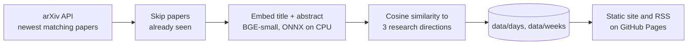

# Paper Radar

[](https://github.com/NyksNightBender/paper-radar/actions/workflows/daily.yml)
[](https://github.com/NyksNightBender/paper-radar/actions/workflows/ci.yml)

**A reading list that builds itself.** Every weekday this pipeline takes the new anomaly-detection papers on arXiv and ranks them by how close they are to my research question: how early can machine learning detect abnormal water consumption?

**Live site: [nyksnightbender.github.io/paper-radar](https://nyksnightbender.github.io/paper-radar/)** (daily and weekly digests, archive, RSS)

<!-- LATEST:START -->
_The first run fills this table._
<!-- LATEST:END -->

## Why

My TÜBİTAK 2209-A project at Ege University compares anomaly detection methods for leaks in water distribution networks and unusual consumption in buildings' smart meters. Dozens of papers mention "anomaly" or "leak" every day; most are irrelevant (a paper about *data leakage* in model training is not about pipes). Keyword alerts can't tell the difference. Embeddings can.

## How it works



1. **Wide net.** The arXiv API is asked for the newest papers whose abstract mentions anomalies, outliers, leaks, fault detection, change points or novelty detection, in ML, statistics, signal processing, systems and data-analysis categories.
2. **Rank by meaning.** Each title and abstract is embedded with [BGE-small](https://huggingface.co/BAAI/bge-small-en-v1.5) through [fastembed](https://github.com/qdrant/fastembed) (ONNX, CPU, no GPU or API key). The research question is written as three short descriptions: *water networks*, *meters and consumption*, and *time-series anomaly detection methods*. A paper's score is its cosine similarity to the closest one, and its tag says which.
3. **Digests.** Papers that appeared since the last run form the day's digest. On weekends, when arXiv is quiet, the week's best papers become a weekly digest.
4. **Schedule.** The workflow runs four times a day and commits only when something new arrived.

The tests replace the embedding model with a keyword counter and the API with a fixture feed, so they run offline in a second.

## Data

| Path | What |
| --- | --- |
| `data/days/YYYY/YYYY-MM-DD.json` | Every new paper of the day with its scores for each research direction |
| `data/weeks/YYYY/YYYY-Www.json` | The week's ten closest papers |
| `data/seen.txt` | arXiv ids already processed |
| [`api/latest.json`](https://nyksnightbender.github.io/paper-radar/api/latest.json) | The latest digest, served by the site |

## Run it locally

```bash
uv sync
uv run paper-radar fetch      # downloads the model once (~130 MB) into .cache/fastembed
uv run paper-radar site       # render the site into _site/
uv run pytest && uv run ruff check . && uv run mypy
```

## Credits

Thank you to arXiv for use of its open access interoperability. Abstracts belong to their authors. Embedding model: BAAI/bge-small-en-v1.5 (MIT). Code: MIT.
